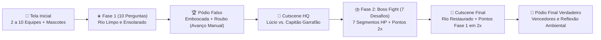

# 🐸 Quiz do S.A.P.A. — Guardiões dos Rios

> **Jogo educativo interativo estilo Kahoot (100% off-line)** desenvolvido para turmas do **5º ano do Ensino Fundamental I (10 a 11 anos)** em apresentações escolares com TV ou projetor, apresentando o projeto **S.A.P.A. (*Sistema de Alerta e Previsão contra Alagamentos*)**.

📥 **Download pronto para jogar (sem instalar nada):** acesse a aba [**Releases do Repositório**](https://github.com/Endrei7/quiz-do-sapa/releases) e baixe o `Quiz_do_SAPA_Qualquer_Notebook.zip` (roda em Windows, MacBook, Linux e Chromebook) ou o `Quiz_do_SAPA_Windows.exe`.

---

## 🎬 Fluxo Narrativo e Gameplay (v3.1)



---

## ✨ Principais Funcionalidades

- **100% Off-line (Zero Dependências Externas):** Sprites, 10 avatares, logotipo e banco de 17 perguntas são embutidos em Base64 (`web/sapa_data.js`), e todos os efeitos sonoros (moedas, fanfarra, trovão, risada do vilão e ataque de água limpa) são sintetizados localmente via **Web Audio API**.
- **Seletor de 2 a 10 Equipes com Mascotes da Amazônia:**
  - 10 animais amazônicos com medalhão colorido, setas `<` `>` e mini-grade modal **5×2**: *Boto-Cor-de-Rosa, Ariranha, Peixe-Boi, Tartaruga, Onça-Pintada, Preguiça, Tucano, Arara-Azul, Pirarucu e Sapo-Boi*.
  - Prevenção automática de mascotes repetidos e sugestão inteligente de nome preservando nomes personalizados digitados pela turma.
- **Pontuação Dinâmica por Quantidade de Equipes (Sem Pressão de Cronômetro):**
  - **Fase 1 (Questões 1 a 10):** `N × 50` descendo de `50` em `50` pontos até `50 pts` (`4 equipes`: `200 → 50`; `8 equipes`: `400 → 50`; `10 equipes`: `500 → 50`).
  - **Reviravolta no Pódio (Avanço Manual):** Após a Q10, o **Capitão Garrafão** invade a tela com raio, trovão e escurecimento do rio, trancando os pontos da Fase 1 no cadeado roxo (`🔒`) até que o apresentador avance manualmente.
  - **Fase 2 — Boss Fight (7 Perguntas Mais Desafiadoras):** Barra de vida de **7 segmentos**, ataque visual de Lúcio a cada rodada vencida e pontuação em **dobro (`2×`)**. Ao derrotar o vilão, o rio volta a ficar cristalino e os pontos da Fase 1 são devolvidos **multiplicados por `2×`** e somados aos da Fase 2!
- **Adaptado para Projetores Escolares (`1280×720` a `1920×1080`):** Layout sem barras de rolagem (`overflow: hidden`), proteção contra duplo clique acidental e suporte a passadores de slide sem fio (`→` / `PageDown`).

---

## ⌨️ Atalhos para o Apresentador (Teclado & Passador de Slides)

| Tecla / Controle | Ação |
| :--- | :--- |
| `1`–`4` ou `A`–`D` | Seleciona a alternativa correspondente durante a pergunta |
| `Espaço`, `Enter`, `→` ou `PageDown` | Avança o alerta de emboscada e cada fala das cutscenes HQ |
| `Enter`, `→` ou `PageDown` | Avança para a próxima pergunta / pódio na tela de resposta |
| `Esc` | Fecha o modal de seleção de mascote (quando aberto) |
| `F11` | Entra ou sai do modo Tela Cheia |

---

## 📁 Organização do Repositório

```text
quiz-do-sapa/
├── main.py                  # Launcher desktop PyWebView (compatível com sys._MEIPASS no .exe)
├── questions.py             # 10 perguntas da Fase 1 + 7 perguntas desafiadoras da Boss Fight
├── build_data_js.py         # Empacota PNGs em Base64 + perguntas dentro de web/sapa_data.js
├── build_portable.py        # Gera HTML único universal + pacotes .zip em dist_colegas/
├── test_webview_flow.py     # Auditoria off-line e teste E2E completo em 1280×720
├── requirements.txt         # Dependências de desenvolvimento (pillow, pywebview, pyinstaller)
├── assets_src/              # Folhas de sprites originais em alta resolução
│   ├── spritesheet.jpeg         # Poses de Lúcio, o Sapo Explorador (3×2)
│   ├── boss_spritesheet.jpg     # Poses do Capitão Garrafão (2×2)
│   └── equipes_spritesheet.jpg  # 10 mascotes amazônicos das equipes (5×2)
├── scripts/                 # Utilitários de recorte e remoção de fundo branco
│   ├── slice_sprites.py
│   ├── slice_boss_sprites.py
│   └── slice_team_sprites.py
└── web/                     # Front-end 100% autocontido e off-line
    ├── index.html           # Interface cartoon, animações SVG/Canvas e Web Audio
    ├── sapa_data.js         # Bundle Base64 gerado automaticamente
    └── assets/              # Sprites PNG transparentes recortados
        ├── sapa_logo.png
        ├── sprites/         # 6 poses de Lúcio + 4 poses do Capitão Garrafão
        └── avatars/         # 10 mascotes das equipes
```

---

## 🚀 Como Executar pelo Código-Fonte

```bash
# 1. Instalar dependências
pip install -r requirements.txt

# 2. Executar janela nativa
python main.py
```

---

## 🛠️ Pipeline de Assets, Testes e Empacotamento

```bash
# (Opcional) Refatiar as sprite sheets a partir de assets_src/
python scripts/slice_sprites.py
python scripts/slice_boss_sprites.py
python scripts/slice_team_sprites.py

# Atualizar bundle Base64 (web/sapa_data.js)
python build_data_js.py

# Executar bateria automatizada completa (1280×720, 10 equipes, emboscada e Boss Fight)
python test_webview_flow.py

# Compilar executável Windows (dist/Quiz_do_SAPA.exe)
pyinstaller --noconfirm --onefile --windowed --name "Quiz_do_SAPA" --add-data "web;web" main.py

# Gerar cópia portátil universal (HTML único + ZIPs em dist_colegas/)
python build_portable.py
```
